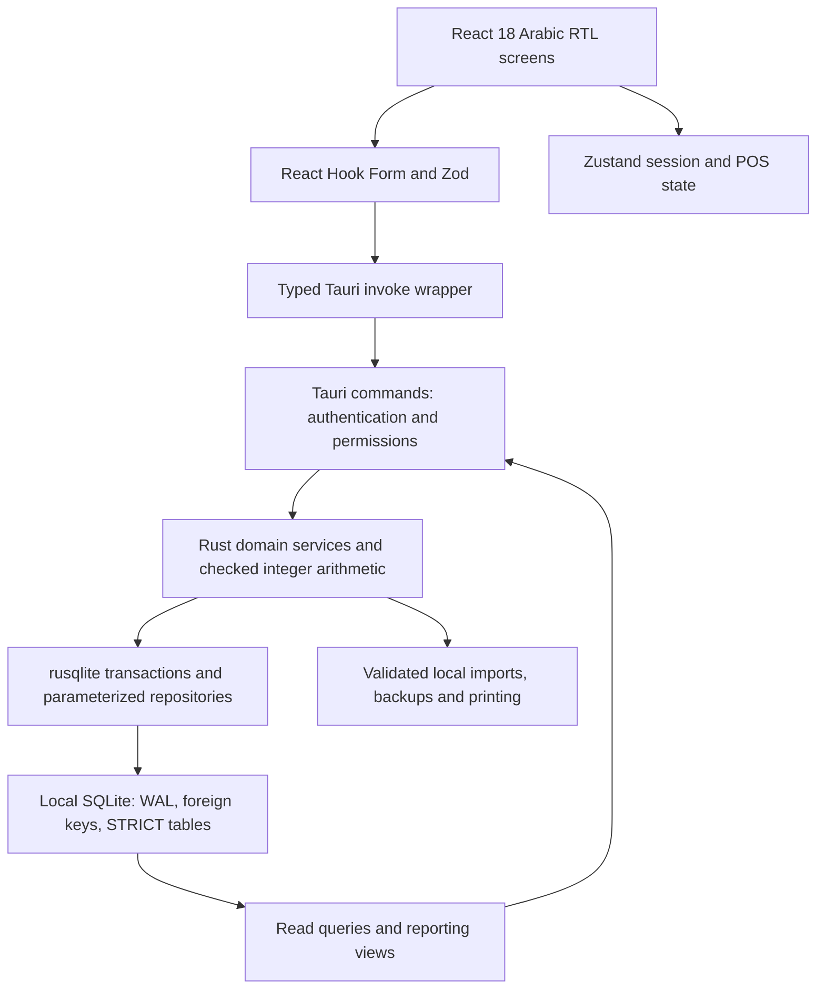

# Arabic plumbing-store ERP — architecture contract

Stage 1 delivers the complete relational schema, reference data, database constraints,
reporting views and schema contract tests. The Rust application, React screens, print
templates and Windows installer are subsequent stages. This document describes their
implementation contract; it does not claim they already exist.

## 1. Deployment and operating assumptions

One store, one base currency, multiple warehouses, multiple named users sharing a
local Windows installation. Only one application instance owns a store database.
No HTTP server, cloud account, telemetry, external CDN, subscription or runtime
internet connection is required. Concurrent workstations sharing a network database
are outside this desktop design.

The target is Windows 10/11 x64 with a supported, preinstalled WebView2 runtime.
Tauri 2 uses that runtime. The compact NSIS installer checks for it and explains the
prerequisite in Arabic; it must not silently download anything. An offline WebView2
redistributable can be supplied separately on USB, or bundled in a larger installer.
Tauri documents approximately 127 MB of additional size for the bundled offline
installer. A universally self-contained installer under 20 MB is consequently not a
feasible requirement for this stack. [Tauri Windows installer documentation](https://v2.tauri.app/distribute/windows-installer/)

Installer <20 MB, total idle private working set <150 MB, and cold start <2 seconds
are release acceptance targets, not measured results at this stage. Memory measurement
includes the application and its WebView2 child processes. Cold start is measured from
process creation to an interactive login screen on a documented reference PC, including
the startup database check. First-run setup, upgrades and restores are measured separately.

Business dates use the store's IANA time zone, initially `Africa/Cairo`; audit timestamps
use UTC RFC3339. EGP and `ج.م` are defaults. A store can select another currency before
its first posting. Currency scale cannot change after posting; symbol and digit style
are presentation settings. Multi-currency accounting is not implied by configurable currency.

## 2. Runtime layers



Commands accept typed request DTOs and return typed results or structured errors:
`code`, Arabic `message`, optional field errors and a retryable flag. They do not accept
SQL, account mappings, arbitrary application paths or caller-supplied user identities.
Services derive the acting user from an in-memory session and check permissions again
inside the command boundary. Hiding a navigation item does not grant or revoke access.

Database writes use a single owned writer connection and `BEGIN IMMEDIATE`. Synchronous
rusqlite operations run off the UI thread. Reports use at most two lazy read connections
with smaller caches and bounded result sets. The writer also owns checkpoints. A
multi-query report reads one snapshot transaction so totals and detail rows agree.

The frontend contains no database access and cannot calculate authoritative postings.
It can preview totals with BigInt, but Rust recomputes every amount before committing.
No ORM, embedded browser distribution, Node service, Python runtime or spreadsheet
engine is shipped in the application.

## 3. Final folder structure

The following is the planned complete application structure. Files delivered in this
stage are listed separately in the repository README. Future-stage paths here are design
decisions, not empty files or runnable scaffolding.

```text
erp_plumbing_store/
├── README.md
├── README_AR.md
├── package.json
├── package-lock.json
├── index.html
├── tsconfig.json
├── tsconfig.node.json
├── vite.config.ts
├── tailwind.config.ts
├── postcss.config.cjs
├── eslint.config.js
├── public/
│   └── fonts/
│       ├── Cairo-Variable.woff2
│       └── OFL.txt
├── src/
│   ├── main.tsx
│   ├── app/
│   │   ├── App.tsx
│   │   ├── routes.tsx
│   │   ├── AppShell.tsx
│   │   ├── Sidebar.tsx
│   │   ├── ErrorBoundary.tsx
│   │   └── styles.css
│   ├── i18n/
│   │   ├── ar.json
│   │   └── index.ts
│   ├── lib/
│   │   ├── api.ts
│   │   ├── contracts.ts
│   │   ├── money.ts
│   │   ├── quantity.ts
│   │   ├── format.ts
│   │   └── shortcuts.ts
│   ├── stores/
│   │   ├── session.ts
│   │   ├── settings.ts
│   │   └── pos.ts
│   ├── components/
│   │   ├── DataTable.tsx
│   │   ├── FormField.tsx
│   │   ├── DecimalInput.tsx
│   │   ├── DateInput.tsx
│   │   ├── Dialog.tsx
│   │   ├── ConfirmDialog.tsx
│   │   ├── ToastProvider.tsx
│   │   ├── Pagination.tsx
│   │   ├── Barcode.tsx
│   │   ├── PartyPicker.tsx
│   │   └── ProductPicker.tsx
│   ├── features/
│   │   ├── auth/{LoginScreen.tsx,ChangePasswordDialog.tsx}
│   │   ├── setup/{FirstRunWizard.tsx,OpeningImport.tsx}
│   │   ├── dashboard/{DashboardScreen.tsx,DashboardCharts.tsx}
│   │   ├── products/{ProductsScreen.tsx,ProductForm.tsx,CategoriesScreen.tsx,ProductUnitsEditor.tsx,ProductImport.tsx,LabelsDialog.tsx}
│   │   ├── inventory/{InventoryScreen.tsx,TransfersScreen.tsx,AdjustmentForm.tsx,StocktakeScreen.tsx,StockCardScreen.tsx,ValuationScreen.tsx}
│   │   ├── sales/{SalesScreen.tsx,PosScreen.tsx,SaleReturnScreen.tsx,QuotationsScreen.tsx,PaymentDialog.tsx,HeldSalesDialog.tsx}
│   │   ├── purchases/{PurchasesScreen.tsx,PurchaseOrderScreen.tsx,PurchaseInvoiceScreen.tsx,PurchaseReturnScreen.tsx,LandedCostsDialog.tsx}
│   │   ├── receiving/{ReceivingScreen.tsx,GoodsReceiptForm.tsx}
│   │   ├── parties/{PartiesScreen.tsx,PartyForm.tsx,StatementScreen.tsx,AgingScreen.tsx}
│   │   ├── finance/{FinanceScreen.tsx,VoucherForm.tsx,ChequesScreen.tsx,ExpensesScreen.tsx,JournalScreen.tsx,CashAccountsScreen.tsx,ShiftScreen.tsx}
│   │   ├── reports/{ReportsScreen.tsx,ReportFilters.tsx,ReportTable.tsx}
│   │   └── settings/{SettingsScreen.tsx,UsersScreen.tsx,PermissionsScreen.tsx,AuditScreen.tsx,BackupScreen.tsx,FiscalPeriodsScreen.tsx}
│   └── print/
│       ├── PrintRoot.tsx
│       ├── InvoiceA4.tsx
│       ├── Receipt80.tsx
│       ├── GoodsReceivedNote.tsx
│       ├── ReportPrint.tsx
│       ├── BarcodeLabels.tsx
│       └── print.css
├── src-tauri/
│   ├── Cargo.toml
│   ├── Cargo.lock
│   ├── build.rs
│   ├── tauri.conf.json
│   ├── capabilities/main.json
│   ├── windows/hooks.nsh
│   ├── icons/{icon.ico,icon.png}
│   ├── db/connection.sql
│   ├── migrations/
│   │   ├── 0001_foundation.sql
│   │   ├── 0002_documents.sql
│   │   ├── 0003_ledgers.sql
│   │   ├── 0004_guards.sql
│   │   ├── 0005_detail_guards.sql
│   │   ├── 0006_views.sql
│   │   └── 0007_reference_data.sql
│   ├── queries/aging.sql
│   ├── seeds/demo_products.csv
│   ├── src/
│   │   ├── main.rs
│   │   ├── lib.rs
│   │   ├── state.rs
│   │   ├── error.rs
│   │   ├── db/{mod.rs,connection.rs,migrations.rs,repositories.rs}
│   │   ├── models/{mod.rs,ids.rs,money.rs,quantity.rs,auth.rs,catalog.rs,documents.rs,inventory.rs,accounting.rs,reports.rs,settings.rs}
│   │   ├── services/{mod.rs,auth.rs,catalog.rs,costing.rs,posting.rs,inventory.rs,sales.rs,purchases.rs,receiving.rs,parties.rs,finance.rs,reports.rs,settings.rs,backup.rs,imports.rs,printing.rs,setup.rs}
│   │   └── commands/{mod.rs,auth.rs,catalog.rs,inventory.rs,sales.rs,purchases.rs,receiving.rs,parties.rs,finance.rs,reports.rs,settings.rs,backup.rs,imports.rs,printing.rs,setup.rs}
│   └── tests/{costing.rs,posting.rs,returns.rs,journal.rs,aging.rs,migrations.rs,permissions.rs,backup.rs}
├── tests/
│   ├── test_schema.py
│   ├── money.test.ts
│   ├── format.test.ts
│   └── pos.test.tsx
├── scripts/
│   ├── export_schema.py
│   ├── check.ps1
│   └── measure-release.ps1
├── docs/
│   ├── ARCHITECTURE.md
│   └── schema.sql
└── .github/workflows/windows.yml
```

Brace groups enumerate individual files; they are not a glob or omitted code. Features
use shared typed contracts instead of duplicating a separate API client for each screen.
Production DDL lives only in migrations; `docs/schema.sql` is a generated, complete,
executable reference with migration receipts. Never edit that generated file by hand.

## 4. Exact arithmetic contract

| Domain | Storage and wire format | Rules |
| --- | --- | --- |
| Money | SQLite INTEGER / Rust i64, decimal-string JSON | Minor currency units; initially 100 piastres = 1 EGP |
| Quantity | INTEGER / i64, decimal-string JSON | 1,000,000 = one base or selected unit; six fractional digits |
| Unit conversion | Positive numerator and denominator | Exact rational conversion; base unit factor = 1 |
| Cost quotation | Integer micro-piastres per base unit | 1,000,000 cost units = one piastre; ledger value is authoritative |
| VAT | Integer basis points | 1,400 = 14%; off means zero tax |
| Identifiers | i64 / decimal-string JSON | Never silently cast to JS Number |
| Dates | ISO `yyyy-MM-dd` | Display `dd/MM/yyyy` without timezone conversion |

All multiplication and division use checked Rust i128 intermediates. Result conversion
to i64 and every database bound are checked. No money, quantity conversion, allocation,
discount or tax calculation uses f32/f64 or JavaScript floating point. Recharts receives
bounded Number values only for plotting after aggregation; labels/tooltips retain the
exact integer strings. SQL `julianday` is used only for date differences, never money.

For nonnegative integer `n` and positive `d`, round half up is
`(n + d/2) / d` using integer division and checked intermediates. Apply the sign after
rounding absolute values. Reject input with excess precision rather than silently
rounding typed quantities. Parse both Arabic-Indic and Western digits and approved
decimal/group separators as text; normalize before Zod and Rust validation.

`base_quantity_micros = quantity_micros * numerator / denominator` must be exact;
reject a quantity that cannot be represented at six decimal places. Line gross is
`round(quantity_micros * unit_price_minor / 1_000_000)`. Apply line discounts, allocate
the invoice discount across remaining line values, then calculate VAT per line on the
discounted base. Prices are VAT-exclusive. Percentage input is converted to a fixed
integer discount amount; stored line totals are immutable snapshots.

Proportional discounts, landed charges and partial-return values use the largest
remainder method, with line number as the deterministic tie-breaker. Allocation shares
sum exactly to the original minor-unit total. Never discard a rounding remainder.

## 5. Stock valuation and ordering

Stock quantity and value come from the immutable stock ledger. There is no editable
`products.stock` or `products.average_cost`. `standard_cost_minor` is a catalogue
default and a validated fallback for explicitly permitted negative-stock issues.

Maintain weighted-average cost per product and warehouse. If quantity is `Q` micros
and value is `V` minor units, an issue of `q` micros costs `round(V*q/Q)`. When issuing
all remaining stock, consume exactly `V`. The displayed average cost in micro-piastres
is `round(V*1_000_000_000_000/Q)`; do not cost issues from that rounded display value.
Receipts increase quantity and value by accepted quantities and allocated cost.

Example: 10 units valued at 10,000 piastres plus 5 units valued at 6,000 gives
15 units / 16,000 piastres. Issuing 3 units costs 3,200 piastres; the remaining
12 units are valued at 12,800. This is independent of retail price.

Costing order is the stock-movement ID, established under the writer transaction.
Stock-affecting documents cannot be backdated before the latest movement date for
an affected product/warehouse. Reversals and corrections use an open current date;
posted history is never rewritten. Reports order stock cards by movement ID and retain
both document date and audit timestamp.

When negative stock is enabled, issues beyond zero use the last positive average or
an explicitly supplied standard cost. A receipt covering negative quantity compares
the actual cost of the covered units with their provisional issue cost; the difference
posts to COGS and the stock value is adjusted in the same transaction. For example,
-5 units / -5,000 piastres followed by 10 units costing 12,000 produces inventory
of 5 units / 6,000 and an additional 1,000 COGS. It must not leave 5 units valued at
7,000. Negative-stock mode therefore requires the cost reconciliation service, not
merely disabling the SQL check.

Sales returns restore the original sale's allocated COGS, capped cumulatively by source
quantity and value, with the final return consuming the original rounding remainder.
Purchase returns remove inventory at current average cost and reverse the supplier
amount at the original invoice value; any difference posts to purchase variance.
Transfers conserve quantity and value for each line and re-average the destination.

Known landed costs are allocated before receipt posting. Late charges and invoice-cost
differences append current-date value adjustments. The costing service replays affected
weighted-average pools, propagating through transfers and source-linked returns, to
separate remaining-inventory value from already-expensed COGS. It posts only the delta;
it does not mutate old movements or reopen a locked period. The allocation retains the
receipt reference and the inventory/COGS split for audit.

Stocktake captures a high-water movement ID, expected quantity and counted quantity
per product. Posting aborts if an affected product moved after its snapshot; the user
refreshes/recounts it. Only the difference becomes an adjustment, with a reason.

## 6. Document and accounting lifecycle

Draft and held documents have editable details and no ledger entries. Purchase orders
and quotations can be approved, then closed or cancelled. Purchase-order receipt progress
is derived: approved → partially received → closed; manual closure records short supply
and a reason. Approval validates nonempty lines and totals in the service.

Posting uses `draft → posting → posted` within one SQLite transaction. `posting` is
an internal state, never a user workflow or a committed state. SQLite has no deferred
commit trigger for this invariant: the transaction wrapper owns it. Startup rejects an
unexpected persisted `posting` row and offers recovery from a verified backup.

1. Authenticate and authorize the command; validate the request and idempotency key.
2. Acquire the writer and begin an immediate transaction.
3. Recheck revision, fiscal lock, active masters, quantity precision, stock and credit.
4. Recompute every monetary field, load original snapshots for returns, allocate costs.
5. Allocate the document number from `(kind, year)` inside the transaction.
6. Freeze party/store/product/unit/category/price/tax snapshots and mark `posting`.
7. Append stock movements, journal entry/lines, payment legs' corresponding accounting,
   cheque events and settlement matches as applicable.
8. Validate service invariants and pass the SQL posting gate; mark `posted`.
9. Append document events, audit log and request receipt with the result; commit.

Any failure, including audit/idempotency recording, rolls back everything. A repeated
request ID with the same command, user and payload returns the stored response; a
changed payload is rejected. No automatic retry may generate a new invoice number.
Print/export happens after commit and can be retried independently.

Posted documents and their details are immutable. Cancelling a posted invoice creates
a `reversal` document with exact opposite movement and journal-line references; the
original remains `posted` and is displayed as reversed by its link. Dependent returns,
invoice/receipt matches, settled items and cheque clearances must be unwound in valid
order. Reversal services also unmatch settlements and match opposite open items so
aging does not show fictitious overdue balances. Cancelled draft reversal requests do
not prevent a later valid reversal.

| Event | Debit | Credit | Stock effect |
| --- | --- | --- | --- |
| Sale invoice | AR for named party, or cash/bank/cheque for fully paid walk-in | Net sales and output VAT | Quantity/value out; Dr COGS, Cr inventory |
| Named-party sale payment | Cash/bank/received cheque | AR, then settlement against sale | None |
| Sales return | Sales returns and output VAT reversal | AR or refund clearing | Original COGS back in; Dr inventory, Cr COGS |
| Goods receipt | Inventory | Goods received not invoiced (GRNI) | Accepted stock in only |
| Supplier invoice | GRNI and input VAT; inventory/COGS differences when needed | AP | No duplicate quantity receipt |
| Purchase return | AP and applicable variance | Inventory, input VAT; applicable variance | Quantity out at current average |
| Supplier payment/advance | AP | Cash/bank/issued cheque | None |
| Expense | Expense category and eligible input VAT | Cash/bank or AP | None |
| Opening stock | Inventory | Opening equity | Opening quantity/value in |
| Opening customer/supplier balance | AR or opening equity | Opening equity or AP | None |
| Shortage/overage | Stock variance or inventory | Inventory or stock variance | Signed difference |
| Cash/bank transfer | Destination cash/bank | Source cash/bank | None |
| Received cheque cleared | Bank | Cheques under collection | None |
| Issued cheque cleared | Issued cheques | Bank | None |
| Cheque bounced | Reverse collection/payment according to last state | Corresponding clearing/bank/party account | None |

Zero-value documents require no artificial zero-sided journal lines. A free sale with
nonzero COGS still has a balanced inventory/COGS entry. Manual journals always require
at least two nonzero, balanced lines. Inventory control postings must reconcile exactly
to stock value changes; a manual journal cannot change inventory without a stock document.

Credit is the unpaid residual, not a fictitious `credit` payment leg. Split payment is
multiple cash/bank/cheque legs. A walk-in sale must be fully paid; partial or credit
sales require a customer. The service checks credit exposure in the same transaction
as posting. The warning policy requires acknowledgement; the block policy requires
the separate override permission and an audited reason.

AR/AP journal lines carry party and due date. Immutable settlements pair a debit and
credit for the same party/control account, with bounded amounts. This supports partial
payments, advances, opening balances and credit notes without a mutable party balance.
Negative settlement rows undo an exact previous match. Historical aging includes only
documents and settlements effective by `as_of`, separates unapplied credits, and uses
nonoverlapping buckets: not due, 0–30, 31–60, 61–90, and over 90 days.

## 7. Schema coverage and integrity responsibilities

| Area | Tables and views |
| --- | --- |
| Access | users, roles, permissions, user_roles, role_permissions |
| Store and periods | store_settings, fiscal_periods, document_types, number_sequences |
| Catalogue | categories, units, products, product_units, product_search |
| Warehouses | warehouses, warehouse_product_settings, stock_movements, stocktake_lines |
| Parties | parties, journal_lines, settlements, v_party_open_items, v_party_balances |
| Shared documents | documents, document_lines, document_events |
| Purchasing/receiving | receipt_lines, purchase_matches, landed_charges, landed_allocations, v_purchase_order_progress |
| Finance | accounts, posting_accounts, journal_entries, journal_lines, expense_categories, expense_lines |
| Cash and cheques | cash_accounts, cash_shifts, payment_legs, cheques, cheque_events |
| Operations | schema_migrations, audit_log, command_receipts, backup_runs, import_batches |
| Reports | v_stock_on_hand, v_stock_card, v_low_stock, v_journal, v_trial_balance, v_cash_balances, v_cash_flow, v_product_profit, v_vat_summary, v_cheque_register |

SQL enforces types, bounds, FK ownership, unique barcodes/numbers, valid dates,
nonoverlapping fiscal periods, noncyclic hierarchies, state transitions, immutable
ledgers, protected details, balanced posting, inventory/control-account reconciliation,
stock quantities matching invoices, default negative-stock prevention, transfer
conservation, return quantity limits, PO receipt limits, supplier invoice/receipt
matching limits, cost-allocation sums and settlement limits. Every child foreign key
has an index whose leading columns cover it; tests inspect this mechanically.

Services additionally enforce user permissions, password hashing, idempotency payload
identity, checked multiplication, conversion exactness, monetary return limits,
original tax/discount proration, price/credit overrides, movement costs, active base-unit
presence, approval totals, cash/cheque-leg reconciliation, purchase accrual values,
late-cost replay, reversal dependencies, audit contents and completion before commit.
The SQL guards are defense in depth; direct SQL access is not an alternative application
API. The schema tests deliberately distinguish constraints from future Rust services.

Use SQLite STRICT tables, FTS5 and foreign keys. Enable connection pragmas before
transactions and check their results. Foreign keys are a per-connection requirement.
[SQLite STRICT tables](https://www.sqlite.org/stricttables.html),
[SQLite foreign-key documentation](https://www.sqlite.org/foreignkeys.html).

Bundle a patched SQLite through rusqlite: require SQLite 3.51.3 or newer for production
builds and assert the linked version in Rust CI. This avoids the documented concurrent
WAL checkpoint/reset defect. The Python schema harness on this machine uses SQLite
3.47.2 and tests constraints, not production WAL concurrency. Keep live databases on
local disks; WAL does not support network filesystems.
[SQLite WAL documentation](https://www.sqlite.org/wal.html).

Each versioned migration runs inside `BEGIN IMMEDIATE`, records its name and SHA-256,
and commits only after FK validation. Startup refuses changed checksums, unknown newer
versions and gaps. Back up before upgrading an existing store. Applied migrations are
immutable after release; evolve with a new version. Migration scripts contain no
transaction-control or connection PRAGMA statements. The first migration creates its
own receipts table. Migration reference-data inserts never create a default login.

## 8. Arabic interface and workflows

The HTML root is `lang="ar" dir="rtl"`. Bundle the licensed Cairo WOFF2 font with
its OFL; use no remote font requests. Static UI copy, navigation, validation messages,
permission captions and print labels live in `src/i18n/ar.json`. Arabic names stored
as editable business data and seeded chart-of-account names are data, not UI copy.
Database errors have Arabic fallback messages and are mapped to stable application
error codes; raw SQL/internal paths are not shown to users.

Tailwind uses `ms/me`, `ps/pe`, `start/end`, text-start/text-end and logical borders.
Numbers, codes, barcodes and phone fields use isolated LTR segments inside RTL forms.
The digit preference changes display and print formatting, never saved values or barcode
payloads. Dates display `dd/MM/yyyy`; sorting uses ISO values. Monetary inputs are text
with decimal input mode, not HTML floating-point number inputs.

TanStack Table uses backend sorting and bounded pagination (default 50, maximum 200).
Barcode lookup is exact and indexed across all product units. Normalized Arabic FTS
handles diacritics, tatweel and common alef/ya variants without changing saved names;
parameterized prefix fallback supports codes. Search uses a short debounce and request
sequence checks so stale results cannot overwrite newer scans. Product lists never
load all products into Zustand.

POS keeps focus on scan/search; Enter adds, arrows choose results, F2 focuses search,
F4 selects the customer, F6 opens payment, F8 holds/resumes and F9 posts. Esc dismisses
the active dialog. Shortcuts ignore text-editing contexts where applicable, show in
Arabic help, and never bypass validation or permission checks. Posting disables repeat
activation while retaining its request ID. On failure the draft remains reviewable.

All feature routes are lazy loaded. Recharts loads only with dashboard/report charts;
JsBarcode loads only for labels/print. React Hook Form and Zod are shared; Zustand owns
session, preferences and unsaved POS state, while persisted documents remain authoritative
in SQLite. Dialogs trap/restore focus; forms have Arabic accessible labels and error summaries.

CSV import/export is UTF-8 with BOM for Excel compatibility. Spreadsheet import supports
`.xlsx` and legacy `.xls` through Rust `calamine`; export uses `rust_xlsxwriter` for `.xlsx`.
No Office installation is needed. Validate file size/row limits, show a preview with
row-level errors, detect duplicate codes/barcodes, and explicitly select create/update
behavior before applying. Export formula-looking cells as text. Files are processed in
Rust with bounded memory; import batches retain checksum and source name. Opening stock
and balances use the normal audited posting services, never direct ledger injection.

Demo mode is an explicit first-run option or developer flag, seeded once only on a new
store. It adds approximately 100 named Arabic products spanning pipes, fittings, valves,
mixers, pumps, tanks and tools, multiple units and sample parties/documents. It is separate
from mandatory reference data and must not populate an existing production store.

## 9. Print and PDF contract

Print models read frozen document snapshots, so later product, price, party or store
changes cannot alter an old invoice. Provide A4 invoice, 80 mm receipt, goods-received
note, stocktake count sheet, reports and configurable label grids. Use HTML/CSS and the
bundled Arabic font for shaping. A hidden print route receives a typed model, waits for
`document.fonts.ready` and images, then calls native WebView2 printing/PDF APIs through
a narrowly scoped Windows Rust adapter. Avoid browser screenshots and canvas text PDFs.

A4 uses `@page size: A4`, repeated table headers, stable numeric columns, sensible page
breaks and page footer totals. The thermal layout uses an 80 mm page and approximately
72 mm printable content with no navigation or clipped RTL labels. Barcodes retain ASCII
digits and human-readable captions; all other numbers follow the configured digit style.
Report filters, dates, store identity and generation time appear on printed reports.

PDF/font/RTL behavior and thermal margins must be visually tested on Windows before
release. Print failure never rolls back a committed invoice; reprint is available with
an audit event. Export paths come from a native save dialog and are validated in Rust.

## 10. Security, startup and backup

Passwords use Argon2id with random salts and PHC strings. Benchmark parameters on the
reference PC; verification is transient work and is not part of idle RAM. Sessions are
memory-only and expire after inactivity or logout. Enforce failed-login throttling and
active-user checks, clear sensitive state on logout, and require the existing password
or authorized administrator for password resets. Never seed a known admin password.
First run creates the administrator, store profile and fiscal period transactionally.

Use a minimal Tauri capability allowlist and CSP, no remote navigation or remote script
execution, and no unrestricted shell/filesystem plugin exposure. Local logo/product
images are size-limited, validated and copied under an application-owned asset folder;
persist relative paths. File dialogs grant access only to the specific import/export,
backup or restore action. Passwords and session material must never appear in audit JSON.

Store files under the Tauri application-local-data directory, using one database per
store. Keep backups outside the live database directory. On startup perform SQLite
`quick_check` and `foreign_key_check` before enabling writes; run full `integrity_check`
for backups, restores, migration verification and on-demand maintenance. An integrity
failure opens recovery mode, not a newly empty store. Profile check latency as data grows.

Automatic backup runs once per store-local day while the app is open and on the next
startup after a missed day. Retain the latest 30 successful daily backups. Manual and
pre-restore backups are never deleted by daily rotation. Use rusqlite's online backup
API to create a consistent database snapshot; never copy a live `.db` alone and omit
its WAL. Package the snapshot, managed image assets, manifest, schema version and SHA-256
checksums into a local archive. Verify the reopened snapshot before marking success.

Restore validates archive paths/sizes, hashes, schema compatibility, FK and integrity
checks in a staging directory. Stop writes, close all DB connections, take a verified
pre-restore backup, then replace the store directory atomically with rollback recovery
on failure. Keep all staging/replacement operations on the same volume. The UI reports
unavailable USB targets and disk-full failures in Arabic and preserves the live store.

## 11. Validation and delivery gates

Stage 1 tests apply the actual SQL to independent databases and exercise valid postings
and adversarial writes, including atomic rollback, reversal, quantity limits, historical
aging, FTS maintenance, indexes, locks and currency scale. They are executable now with
Python's standard library; Python is not part of the shipped runtime.

Stage 2 adds Rust unit/property and transaction tests for checked amounts, weighted
average and depletion, fractional units, negative-stock reconciliation, invoice posting,
all return paths, balancing, aging and authorization. Stage 3 adds keyboard and RTL
component tests. Stage 4 renders and visually verifies Arabic print/PDF samples. Stage 5
builds with locked dependencies on Windows MSVC, runs tests and creates the NSIS `.exe`.
Stage 6 delivers the final Arabic user guide and complete developer/build documentation.

Release checks include a new-store install, offline launch, store upgrade, restore to
another local folder, simulated power loss/failed transaction, Arabic font rendering,
100,000-product search with a large movement history, scanner keyboard flow, financial
reconciliation and all three performance targets. Pin exact dependency versions and
commit both lockfiles. Do not label a release production-ready or report a target as
achieved until these checks and the Windows installer have actually been run.
